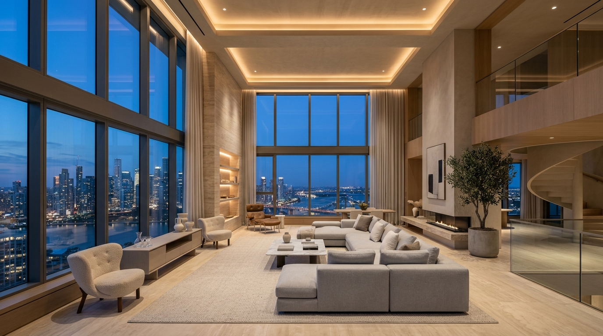

# AURA™ Architectural Ceiling Fans

<div align="center">



### Luxury Aerodynamic Ceiling Fans & Real-Time 3D Studio Configurator

[](https://vitejs.dev/)
[](https://threejs.org/)
[](https://developer.mozilla.org/en-US/docs/Web/JavaScript)
[](https://developer.mozilla.org/en-US/docs/Web/CSS)
[](LICENSE)

[**Live Demo**](https://vvarun97.github.io/ceiling-fan/) • [**Explore Features**](#key-features) • [**Quick Start**](#quick-start) • [**Deployment**](#deployment)

</div>

---

## 🌟 Overview

**AURA™ Architectural Ceiling Fans** is a modern e-commerce web application featuring a real-time **interactive 3D spinning ceiling fan customizer**. 

Users can select finishes and colors (such as *Matte Onyx Black*, *Brushed Champagne Brass*, *American Walnut*, *Scandinavian Nordic White*, *Organic Bleached Oak*, and *Titanium Gunmetal*), and see the rotating 3D fan's materials, textures, and reflections transform dynamically in real time.

Built with **Three.js WebGL**, **Vanilla CSS**, and **modern JavaScript (ES Modules)**, AURA combines architectural aesthetics, physical rotational inertia, circadian ambient lighting, an interactive aerodynamic airflow vortex, and a complete e-commerce checkout flow.

---

## ✨ Key Features

### 🌪️ Interactive 3D Spinning Fan & Color Configurator (Three.js WebGL)
- **Real-Time Color & Finish Transformations**:
  - **Matte Onyx Black**: Industrial satin powdercoat with dark gunmetal hardware.
  - **Brushed Champagne Brass**: Luxurious metallic luster with brushed reflection highlights.
  - **American Walnut Hardwood**: Procedural concentric wood rings, wavy grain, and dark bronze accents.
  - **Scandinavian Nordic White**: Crisp chalk velvet finish with chrome accents.
  - **Natural Bleached Oak**: Organic blonde timber grain with satin white hardware.
  - **Titanium Gunmetal**: Aerospace PVD metallic dark reflection.
  - **Coastal Matte Sage**: Modern organic ceramic matte tone.
  - **Burnished Rose Copper**: High-end architectural copper sheen.
  - **Dual-Tone Finish Toggle**: Contrast motor housing and aerodynamic blades (e.g., Champagne Brass motor with Walnut blades).
- **Physical Rotational Inertia & Speed Modulation**:
  - **6-Speed Calibration**: `OFF` (0 RPM), `1` (Whisper 65 RPM), `2` (Gentle Breeze 120 RPM), `3` (Comfort 175 RPM), `4` (High Velocity 230 RPM), `5` (Turbo Cyclone 290 RPM).
  - Realistic deceleration and acceleration curves mimicking high-torque brushless DC motors.
- **Reversible Airflow Direction**:
  - **Summer Mode (Downdraft)**: Counter-clockwise rotation creating a downward cooling breeze.
  - **Winter Mode (Updraft)**: Clockwise rotation circulating warm air trapped near the ceiling.
- **Aerodynamic Wind Vortex Particles**:
  - 220 procedural floating streamlines illustrating the spiral airflow column.
- **Live Telemetry HUD**:
  - Digital tachometer displaying real-time **RPM**, air displacement velocity (**CFM** up to 6,850), acoustic rating (**18.2 dB**), and motor status.
- **Integrated Circadian LED Light Kit**:
  - Dimmable optical dome with Kelvin temperature transitions (`2700K Warm`, `4000K Neutral`, `6000K Daylight`) casting real-time dynamic light and shadows onto the room and ceiling.
- **3D Studio Camera Angles**:
  - Presets for `3/4 Studio View`, `Ceiling Vortex View` (looking straight up from beneath the blades), `Side Profile`, and `In-Room View`, plus full 360° mouse drag orbit and scroll zoom.
- **Procedural Acoustic Breeze Synth**:
  - Ambient airflow synthesizer utilizing the **Web Audio API** with rhythmic pink noise filters dynamically modulated by the fan's RPM.

---

### 🛒 Complete E-Commerce Storefront
- **Dynamic Live Pricing Engine**: Real-time price calculations reflecting selected finishes, blade counts (3, 4, or 5 blades), blade spans (44", 52", 60"), downrod lengths (Flush, 6", 12", 24"), and smart home kit add-ons.
- **Slide-Out Cart Drawer**:
  - Visualized item summary with finish preview swatches, quantity steppers, and item removal.
  - Free White-Glove Shipping progress threshold bar.
  - Promo code system (enter `AURA15` for 15% discount).
- **Express Checkout Modal**:
  - Express payment options (**Apple Pay**, **Google Pay**, and card details simulator).
  - Order confirmation screen with unique order tracking ID and celebratory **confetti animation**.
- **Wishlist Drawer**: Save your custom fan configurations to your design board.
- **Spatial Room Sizer & CFM Calculator**:
  - Interactive room dimension sliders (Length, Width, Ceiling Height) calculating square footage.
  - Recommends the exact blade diameter, downrod drop, and CFM requirements with a one-click **"Apply Settings to 3D Customizer"** action.
- **Collections Catalog**: 4 models (*Aura Vortex V1*, *Aura Halo Smart*, *Aura Zephyr Woodcraft*, and *Aura Stratos 5-Blade*) with individual color swatches and 3D Studio loading.

---

## 🛠️ Tech Stack

- **Core**: HTML5, Vanilla JavaScript (ES2022 Modules)
- **Styling**: Vanilla CSS (Custom Design System, Glassmorphism, Dark Luxury Theme)
- **3D Graphics**: [Three.js](https://threejs.org/) (WebGL, PCFSoftShadowMap, PBR Materials, Custom Procedural Canvas Textures)
- **Audio**: Web Audio API (Synthesized Pink Noise & Biquad Lowpass Modulation)
- **Bundler & Dev Server**: [Vite](https://vitejs.dev/)
- **Icons**: [Lucide Icons](https://lucide.dev/)
- **Visual Effects**: [Canvas Confetti](https://www.npmjs.com/package/canvas-confetti)

---

## 🚀 Quick Start

### Prerequisites
Make sure you have [Node.js](https://nodejs.org/) (v18 or newer) installed.

### Installation

1. **Clone the repository:**
   ```bash
   git clone https://github.com/VVarun97/ceiling-fan.git
   cd ceiling-fan
   ```

2. **Install dependencies:**
   ```bash
   npm install
   ```

3. **Start the development server:**
   ```bash
   npm run dev
   ```

4. **Open in your browser:**
   ```
   http://localhost:5173/
   ```

---

## 📦 Building for Production

To create an optimized, minified production bundle:

```bash
npm run build
```

The compiled files will be output to the `dist/` folder, ready for deployment on any static host.

To preview the production build locally:
```bash
npm run preview
```

---

## 🌐 Deployment Guide

### Deploying to Vercel (Recommended)
1. Install Vercel CLI:
   ```bash
   npx vercel
   ```
2. Follow the prompts to log in and deploy. Vite is auto-detected.

### Deploying to Netlify
1. Run `npm run build`.
2. Visit **[app.netlify.com/drop](https://app.netlify.com/drop)**.
3. Drag and drop the `dist` folder directly onto the page.

### Deploying to GitHub Pages
1. Install `gh-pages`:
   ```bash
   npm install --save-dev gh-pages
   ```
2. Add a deploy script to `package.json`:
   ```json
   "scripts": {
     "deploy": "vite build && gh-pages -d dist"
   }
   ```
3. Run:
   ```bash
   npm run deploy
   ```
4. In your GitHub repository, enable GitHub Pages from the `gh-pages` branch under **Settings** > **Pages**.

---

## 📁 Project Structure

```
ceiling-fan/
├── index.html               # Main HTML5 entry point & UI structure
├── package.json             # Project metadata, dependencies, and scripts
├── vite.config.js           # Vite configuration with universal relative base
├── .gitignore               # Ignored files for version control
├── public/
│   └── images/              # High-resolution architectural interior photography
└── src/
    ├── style.css            # Complete design system, dark palette, & animations
    ├── fan-3d.js            # Three.js 3D fan engine, procedural textures, & spin physics
    ├── audio.js             # Web Audio API ambient airflow synthesizer
    ├── store.js             # Application state management, pricing, & cart logic
    └── main.js              # Application orchestrator, event bindings, & UI sync
```

---

## 📄 License

This project is open-source and available under the [MIT License](LICENSE).

---

<div align="center">
Crafted with precision for modern architectural spaces.
</div>
